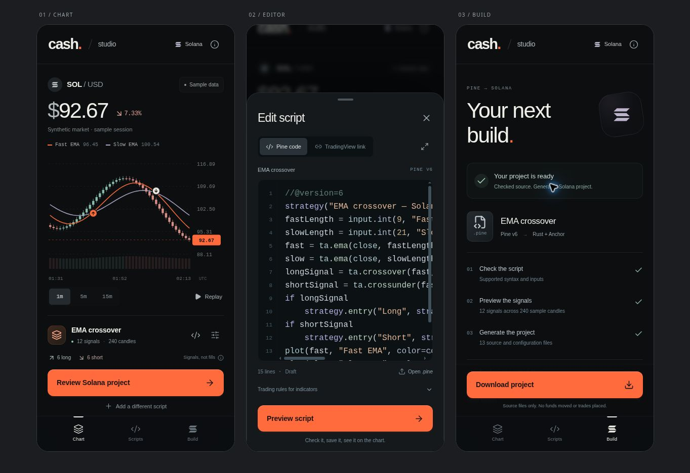

# Pine Studio

Pine Studio is the mobile-first interface to the experimental Pine-to-Solana compiler, available at `/pine`. It uses the same compilation API, intermediate representation, and runtime as the command-line compiler. There is no separate simulated compiler behind the interface.

## Workflow

1. **Chart:** start with a checked EMA crossover, inspect candles, switch between 1-, 5-, and 15-minute aggregation, or replay the sample history. The price, indicator values, and signal markers come from the bundled synthetic fixture. Signal counts are order intents, not executed fills or a profit estimate.
2. **Editor:** paste Pine code, open a `.pine` file, select a starter, or import available public TradingView source. Script title and version are detected from the source. The single **Preview script** action compiles, applies, and saves a successful script. Errors retain the draft and identify the relevant line. An indicator needs explicit trading conditions before it can generate a trading program.
3. **Scripts:** search scripts saved in this browser, reopen them, or remove them with an Undo action. EMA, RSI, and MACD starters are available. Successful source/configuration changes are saved locally; dismissing a sheet retains the current in-memory draft. Reloading the page does not retain an unsubmitted draft.
4. **Build:** review the checked source and configuration, inspect generated files, and download a ZIP containing the compiler's source and configuration files. Unapplied edits to the active script block export until the preview is updated. File inspection explicitly identifies an older checked version when edits exist.

## Interface

The phone layout prioritizes the chart, an active-script row, one primary action, and bottom navigation. A native dialog provides modal focus management and Escape dismissal. The editor includes syntax colors, line numbers, an expandable layout, keyboard-aware height, and scroll access on short viewports. Desktop adds a source panel beside the chart. Reduced-motion preferences and keyboard chart inspection are supported.

## Data and execution boundary

- The chart contains 240 synthetic one-minute candles. Timeframe aggregation preserves OHLCV and omits incomplete windows.
- The browser replays the real compiled graph, including missing warmup samples and explicit order intents. Source plots do not automatically become trades.
- Code is sent to `POST /api/launchpad/compile-solana` for validation and source generation. Saved scripts stay in browser storage. Public link import uses the existing TradingView source endpoint and cannot retrieve protected code.
- ZIP generation is local, deterministic, UTF-8 compatible, and includes CRC32 integrity fields. Unsafe archive paths and oversized exports are rejected.
- This workspace does not connect a wallet, deploy to a Solana network, move funds, execute a DEX trade, or emulate TradingView's broker. It supports the compiler's documented subset, not every Pine script.

## Implementation

| Path | Responsibility |
| --- | --- |
| `app/pine/page.tsx` | Initial checked example and plain-JSON server/client boundary |
| `components/pine-studio/PineStudio.tsx` | Navigation, editor, compile requests, local scripts, project review |
| `components/pine-studio/PineChart.tsx` | Responsive candles, indicator overlays, intent markers, inspection |
| `components/pine-studio/pine-studio.css` | Scoped responsive layout and visual system |
| `lib/pine-solana/studio-model.ts` | Browser-safe examples, aggregation, real-runtime replay, ZIP packaging |
| `tests/pine-solana-studio.test.ts` | Eight data and artifact integrity tests |

## Verification

The compiler and studio model test suite passes 160 tests. Studio tests verify exact aggregation, missing samples, explicit plot selection, runtime failures, the 12 EMA intents, archive contents, Unicode, CRC32, unsafe paths, and resource limits. The interface passes a TypeScript check in the standalone preview project. Browser review covers desktop and 390px/430px mobile layouts, source error/recovery, stale export protection, input changes, saved scripts, examples, and generated-file review.

The ZIP bytes were independently opened and checked with Python's standard ZIP reader. Browser export initiates a Blob download; the cloud browser's download-event capture did not return a file, so captured download delivery is not claimed. This does not replace physical iOS/Android device testing or TradingView differential certification.
